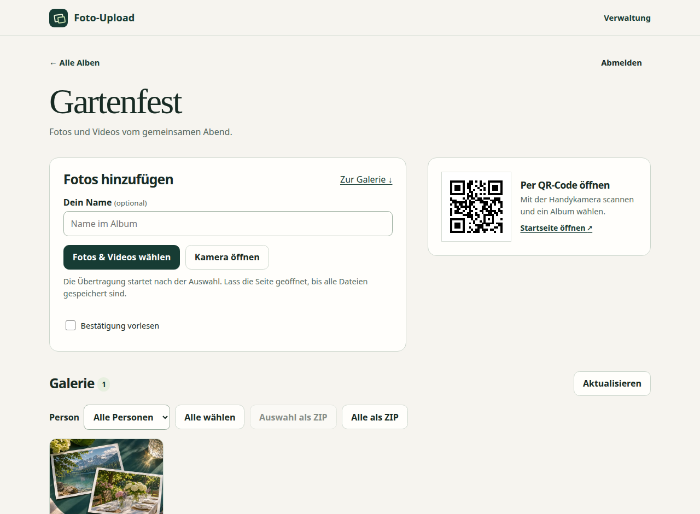
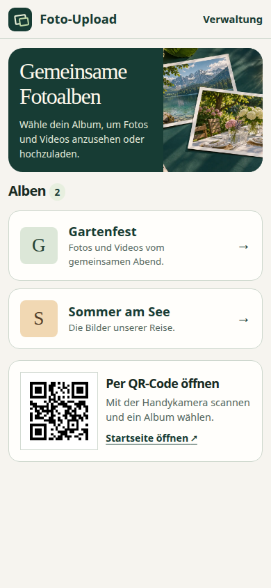

# Foto-Upload

Foto-Upload sammelt die Fotos und Videos einer Feier oder Reise auf deinem eigenen Server. Gäste scannen einen QR-Code, öffnen ihr Album und laden Originale direkt vom Handy hoch. Die Oberfläche ist auf Deutsch. Die App läuft auf CasaOS und anderen Linux-Servern mit Docker.

**[Manuelle Installation](INSTALLATION.md)** · [Downloads für AMD64 und ARM64](https://github.com/ThomS263/foto-upload/releases/latest) · [Android-App mit APK](https://github.com/ThomS263/foto-upload-android) · [Wiki](https://github.com/ThomS263/foto-upload/wiki)

**Auf CasaOS** die verlinkte YAML öffnen und den gesamten Text im **App Store → Custom Install → Import** einfügen. Im Dialog unter `PHOTO_ADMIN_PASSWORD` ein eigenes Erstpasswort setzen und **Installieren** wählen. CasaOS lädt das passende Image. [YAML für den CasaOS-Import öffnen](https://raw.githubusercontent.com/ThomS263/foto-upload/v3.8.0/Apps/FotoUpload/docker-compose.yml)

## Schnellstart mit Docker Compose

Auf dem Server mit installiertem Git und Docker Compose v2 ausführen.

~~~bash
git clone https://github.com/ThomS263/foto-upload.git foto-upload
cd foto-upload
docker compose up -d --build --wait
docker compose exec -T foto-upload cat /data/.initial-admin-password
~~~

Auf dem Handy oder Computer die IP-Adresse des Servers mit Port `8080` öffnen. Unter **Verwaltung** mit dem angezeigten Passwort anmelden und **Album anlegen** wählen. Jedes Album erhält einen eigenen Ordner und ein eigenes Passwort. Originale und Einstellungen liegen im Verzeichnis `data/`.

## Aktualisieren

Im Terminal des Servers in den vorhandenen Projektordner wechseln und das Update starten:

~~~bash
cd foto-upload
git pull --ff-only origin main
docker compose up -d --build --wait
~~~

Mit `docker compose ps` lässt sich der Status prüfen. Bei einer Installation über die CasaOS-Oberfläche die App-Einstellungen öffnen und das Image auf die aktuelle Version setzen. Der Datenordner muss dabei auf den bisherigen Speicherpfad zeigen. [Weitere Hinweise zu Updates und Sicherungen](INSTALLATION.md)

  
  &nbsp;
  

## Was Gäste und Gastgeber tun können

- Fotos und Videos aus der Mediathek oder direkt von der Kamera hochladen. Große Dateien werden in Blöcken übertragen. Nach einer Unterbrechung kann derselbe Browser die Übertragung fortsetzen.
- Die Galerie nach Dateiname oder Gast durchsuchen, nach Fotos und Videos filtern und als Kacheln, Zeitstrahl oder gruppierte GPS-Orte anzeigen. Gäste können Favoriten setzen und – wenn freigegeben – kommentieren. Langes Drücken wählt Bilder auf dem Handy aus. Eine Vollbild-Diashow sowie Video-Laufzeit und Dateigröße sind integriert.
- Alben anlegen oder archivieren, Passwörter ändern, Titelbild, Farbe und Datum festlegen sowie Upload, Galerie und Downloads getrennt erlauben. Vorhandene Albumordner werden beim Start erkannt.
- GPS-Orte werden standardmäßig nicht an Gäste ausgeliefert und können pro Album ausdrücklich freigegeben werden.
- In der Verwaltung Alben suchen und sortieren, Speicher pro Album, neue Uploads sowie eine Sicherheits- und Funnel-Diagnose prüfen. Dateien können in den Papierkorb verschoben und dort wiederhergestellt werden.
- Gästelinks mit Ablaufdatum anlegen und täglich eine geprüfte Sicherung auf einen zweiten eingebundenen Speicher schreiben.
- Über die Verwaltung eine Sicherung von Originalen, Albumzugängen und Einstellungen herunterladen. Ein zweiter eingebundener Speicher kann eine Kopie erhalten.

Der normale QR-Code öffnet die Albumübersicht. Vorschauen, QR-Codes und die Weboberfläche liefert der eigene Server aus. [Installation, QR-Adresse, Updates und Sicherungen](INSTALLATION.md)

## Sicherheit

Für Zugriff aus dem Internet muss Foto-Upload hinter HTTPS betrieben werden, etwa über einen gepflegten Reverse Proxy mit Let's Encrypt oder den vorhandenen Tailscale Funnel. HTTP ist nur für ein vertrauenswürdiges LAN gedacht. Verwende ein starkes, einzigartiges Adminpasswort und aktiviere in der Verwaltung die optionale Zwei-Faktor-Anmeldung. Rate-Limits, Same-Origin-Schutz, Upload-Signaturprüfung, Sicherheitsheader, eingeschränkte Containerrechte und Dependency-Scanning sind integriert. Details und der vertrauliche Meldeweg stehen in [SECURITY.md](SECURITY.md).

## Entwicklung und CasaOS-Paket

Für die Tests werden Python 3.12, FFmpeg und Chromium über Playwright verwendet.

~~~bash
python3 -m venv .venv
. .venv/bin/activate
python -m pip install -r requirements-dev.txt
python -m playwright install --with-deps chromium
python -m pytest -q test_app.py test_browser.py
python scripts/package_store.py
~~~

Die Browsertests lesen QR-Codes aus Screenshots und prüfen den Gastablauf bei 360, 390 und 1280 Pixel Bildschirmbreite. Der letzte Befehl erstellt die YAML für die manuelle CasaOS-Installation und das ZIP für eine Store-Einreichung unter `dist/`. Das Manifest und die Grafiken liegen unter [Apps/FotoUpload](Apps/FotoUpload).

Die Screenshots zeigen Beispieldaten. Das generierte Titelbild gehört zum Projekt. Das gesamte Projekt steht unter der [GNU Affero General Public License v3.0](LICENSE) (`AGPL-3.0-only`). Wer eine veränderte Version über ein Netzwerk bereitstellt, muss den Benutzern den zugehörigen Quellcode anbieten.
