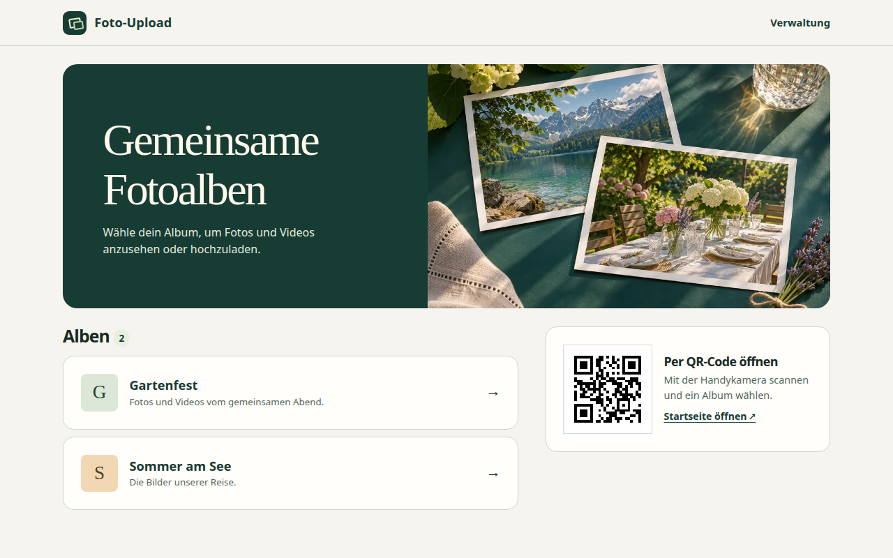

# Foto-Upload

Foto-Upload sammelt die Fotos und Videos einer Feier oder Reise auf deinem eigenen Server. Gäste scannen einen QR-Code, öffnen ihr Album und laden Originale direkt vom Handy hoch. Die Oberfläche ist auf Deutsch. Die App läuft auf CasaOS und anderen Linux-Servern mit Docker.

**[Manuelle Installation](INSTALLATION.md)** · [Downloads für AMD64 und ARM64](https://github.com/ThomS263/foto_upload_offiziel/releases/latest) · [Handyansicht](Apps/FotoUpload/screenshot-2.png)

**Auf CasaOS** die verlinkte YAML öffnen und den gesamten Text im **App Store → Custom Install → Import** einfügen. Im Dialog unter `PHOTO_ADMIN_PASSWORD` ein eigenes Erstpasswort setzen und **Installieren** wählen. CasaOS lädt das passende Image. [YAML für den CasaOS-Import öffnen](https://raw.githubusercontent.com/ThomS263/foto_upload_offiziel/v3.0.1/Apps/FotoUpload/docker-compose.yml)

## Schnellstart mit Docker Compose

Auf dem Server mit installiertem Git und Docker Compose v2 ausführen.

~~~bash
git clone https://github.com/ThomS263/foto_upload_offiziel.git foto-upload
cd foto-upload
docker compose up -d --build --wait
docker compose exec -T foto-upload cat /data/.initial-admin-password
~~~

Auf dem Handy oder Computer die IP-Adresse des Servers mit Port `8080` öffnen. Unter **Verwaltung** mit dem angezeigten Passwort anmelden und **Album anlegen** wählen. Jedes Album erhält einen eigenen Ordner und ein eigenes Passwort. Originale und Einstellungen liegen im Verzeichnis `data/`.

## Was Gäste und Gastgeber tun können

- Fotos und Videos aus der Mediathek oder direkt von der Kamera hochladen. Große Dateien werden in Blöcken übertragen. Nach einer Unterbrechung kann derselbe Browser die Übertragung fortsetzen.
- Die Galerie nach Person filtern, Fotos und Videos in Großansicht öffnen und Originaldateien einzeln, als Auswahl oder als ganzes Album herunterladen. Für HEIC-Fotos erzeugt der Server JPEG-Vorschauen.
- Alben anlegen oder archivieren, Passwörter ändern und bei Bedarf einen widerrufbaren Gästelink mit eigenem QR-Code freigeben. Vorhandene Albumordner werden beim Start erkannt.
- In der Verwaltung Alben suchen und sortieren, freien Speicher prüfen und einzelne Dateien nach Bestätigung löschen.
- Über die Verwaltung eine Sicherung von Originalen, Albumzugängen und Einstellungen herunterladen. Ein zweiter eingebundener Speicher kann eine Kopie erhalten.

Der normale QR-Code öffnet die Albumübersicht. Vorschauen, QR-Codes und die Weboberfläche liefert der eigene Server aus. [Installation, QR-Adresse, Updates und Sicherungen](INSTALLATION.md)

## Entwicklung und CasaOS-Paket

Für die Tests werden Python 3.12, FFmpeg und Chromium über Playwright verwendet.

~~~bash
python3 -m venv .venv
. .venv/bin/activate
python -m pip install -r requirements-dev.txt
python -m playwright install --with-deps chromium
python -m pytest -q test_app.py test_browser.py
python scripts/package_store.py
~~~

Die Browsertests lesen QR-Codes aus Screenshots und prüfen den Gastablauf bei 360, 390 und 1280 Pixel Bildschirmbreite. Der letzte Befehl erstellt die YAML für die manuelle CasaOS-Installation und das ZIP für eine Store-Einreichung unter `dist/`. Das Manifest und die Grafiken liegen unter [Apps/FotoUpload](Apps/FotoUpload).

Die Screenshots zeigen Beispieldaten. Das generierte Titelbild gehört zum Projekt. [Lizenz Apache 2.0](LICENSE)
